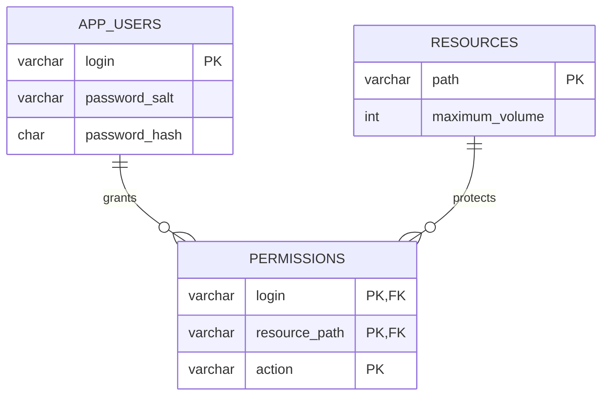

# Лабораторная работа №6: файловое хранилище JDBC

## Сущности, атрибуты и связи

Хранилище — встроенная файловая H2 2.3.232. В рабочем приложении данные читаются из локального файла `data/access.mv.db`. Сервер БД, ORM и система сборки не используются.

| Таблица | Атрибуты | Ограничения |
|---|---|---|
| `app_users` | `login VARCHAR(128)`, `password_salt VARCHAR(128)`, `password_hash CHAR(64)` | `login` — первичный ключ; все поля обязательны |
| `resources` | `path VARCHAR(1024)`, `maximum_volume INT` | `path` — первичный ключ, объём обязателен и неотрицателен |
| `permissions` | `login VARCHAR(128)`, `resource_path VARCHAR(1024)`, `action VARCHAR(16)` | Составной PK по всем трём полям; FK на пользователя и ресурс; действие только READ/WRITE/EXECUTE |

Один пользователь имеет ноль или несколько разрешений, одно разрешение относится ровно к одному пользователю и одному ресурсу. Один ресурс может входить в разрешения многих пользователей. Удаление пользователя/ресурса удаляет зависимые разрешения через `ON DELETE CASCADE`. Отдельные суррогатные идентификаторы не требуются: предметные ключи `login` и `path` уже уникальны.

Иерархия ресурсов кодируется сегментами `path`, разделёнными точкой. Отдельной таблицы родителей нет. Наследование права по сегментам остаётся в `PrefixPermissionPolicy`; лимит читается только у точного ресурса. Пустой набор прав у дочернего ресурса не отменяет разрешение предка.

## ER-диаграмма



## Драйвер и соединение

Драйвер `lib/h2-2.3.232.jar` скачан вручную из Maven Central; SHA-256 зафиксирован в `lib/SHA256SUMS`. Воспроизвести загрузку/проверку можно `bash scripts/setup-libs.sh`. `scripts/build.sh` упаковывает драйвер в `app.jar`, поэтому формат запуска по-прежнему `java -jar app.jar --login ... --password ... --action ... --resource ... --volume ...`.

`H2ConnectionProvider` вручную загружает `org.h2.Driver` и открывает `java.sql.Connection` через `DriverManager.getConnection`. URL рабочего приложения: `jdbc:h2:file:<absolute-path>;IFEXISTS=TRUE;TRACE_LEVEL_FILE=0`. `IFEXISTS=TRUE` не позволяет обычному запуску незаметно создать пустую БД. Трассировка в файл отключена. Учётная запись самой локальной H2 — `sa` с пустым паролем; это учебная файловая БД и отдельный механизм от паролей пользователей приложения.

Переменная окружения `APP_DB_PATH` задаёт путь без расширения `.mv.db`. По умолчанию прямой запуск из корня использует `data/access`; `scripts/run.sh` задаёт абсолютный путь к этому же файлу и работает из любого текущего каталога. Рабочий код не создаёт и не заполняет БД автоматически. Для отсутствующей, недоступной или занятой другой JVM БД возвращается код 9.

## Создание и наполнение

Все SQL и shell-файлы находятся в `scripts/`:

- `init.sql` создаёт три таблицы, первичные/внешние ключи и CHECK-ограничения через `CREATE TABLE IF NOT EXISTS`.
- `fill.sql` транзакционно вставляет отсутствующие начальные строки: 2 пользователя, 6 ресурсов, 5 разрешений. Хранятся только прежние соли и SHA-256-хеши, открытых паролей в БД нет.
- `init-db.sh` последовательно выполняет оба файла штатной утилитой H2 `org.h2.tools.RunScript`. На этом этапе URL допускает создание файла. Приложение после этого использует `IFEXISTS=TRUE`.

```bash
bash scripts/init-db.sh
bash scripts/build.sh
java -jar app.jar --login alice --password qwerty --action read --resource A.B.C --volume 10
```

Повторный запуск `init-db.sh` не создаёт дубликатов и не перезаписывает существующие хеши и лимиты. Он восстанавливает отсутствующие начальные разрешения: это команда наполнения учебной БД, а не миграция пользовательских настроек. DDL H2 фиксируется отдельно, вставка начальных данных выполняется в транзакции с `COMMIT`. При ошибке наполнения незавершённые изменения откатываются при закрытии соединения; ошибки SQL не игнорируются.

БД создаётся локально и остаётся в `data/`, игнорируемой Git. В PR хранятся воспроизводимые SQL и драйвер; двоичный файл рабочей БД не является исходником. Удалять или сбрасывать существующую БД для обычного запуска не требуется.

## Компоненты и изменения архитектуры

1. `ConnectionProvider`, `H2ConnectionProvider` в `adapter/out/jdbc` отвечают только за подключение. Входной CLI и бизнес-код не знают о JDBC URL.
2. `JdbcUserRepository` реализует прежний `UserRepository`: один параметризованный LEFT JOIN загружает соль, хеш и все права пользователя. Пользователь без прав возвращается с пустой картой. `JdbcResourceRepository` реализует `ResourceRepository` и возвращает точный лимит либо null.
3. Общий `JdbcRepository` разделяет сбой открытия соединения и SQL-запроса. `Connection`, `PreparedStatement`, `ResultSet` закрываются вложенными `use` при успехе и исключении. Входные login/path передаются через `setString`, не конкатенируются с SQL.
4. Ошибки адаптера переводятся в независимые от JDBC `StorageConnectionException` и `StorageQueryException`, объявленные рядом с application-портами.
5. `StorageAwareCheckAccessUseCase` декорирует существующий сценарий и преобразует ошибки хранения в `AccessCheckResult`. Алгоритм `DefaultCheckAccessUseCase`, доменные валидаторы и политика наследования не меняются.
6. `CompositionRoot` связывает JDBC-адаптеры вместо memory-репозиториев. `DefaultData.kt` удалён: начальные пользователи, ресурсы и права находятся только в SQL. Memory-адаптеры оставлены для независимых модульных проверок.
7. CLI-презентер преобразует новые результаты в коды 9/10. Для отказа в доступе, превышения лимита и ошибок БД приложение не печатает ни сообщений, ни stack trace. Справка доступна даже без файла БД, поскольку подключение ленивое.

Классы application/domain не импортируют `java.sql` или H2. Зависимости направлены от адаптеров к портам.

## Коды завершения

Прежние 0–8 сохраняются. Дополнительно:

| Код | Условие |
|---|---|
| 9 | Не удалось открыть Connection: нет файла/драйвера, нет доступа, файл занят, неверный путь |
| 10 | Соединение открыто, но SQL-запрос, чтение результата или закрытие ресурса завершились SQLException |

Синтаксические ошибки аргументов по-прежнему обрабатывает `kotlinx-cli` с кодом 127 и её справкой. Это поведение предыдущей работы сохранено; бизнес-проверки и JDBC-ошибки остаются тихими.

## Проверка результата

Добавлены файловые JDBC-тесты: исходные сценарии доступа, точная загрузка прав, пользователь без прав, SQL injection как обычная строка, отсутствие ресурса, нулевой лимит, сохранение изменений после закрытия соединения, повторная инициализация, ограничения схемы, отсутствие файла БД, сломанная схема и закрытие соединений при исключении. Декоратор отдельно проверяется с test doubles.

`bash scripts/test.sh` выполняет JUnit и отдельные JVM CLI. CLI-тесты создают собственную БД в `out/cli-db.*/`, проверяют коды 9/10 и отсутствие stdout/stderr; рабочий файл `data/access.mv.db` не изменяется. JUnit использует временные файловые БД через `@TempDir`.

Проверка 29 октября 2026 года: 176/176 JUnit (151 модульная, 25 интеграционных), 17/17 CLI; пропусков и ошибок нет. Среда: Windows/Git Bash, Kotlin 2.4.20, OpenJDK 26.0.2.1. XML-отчёт создаётся в `out/test-results/TEST-junit-jupiter.xml`. Ссылка на PR указана в итоговом сообщении к работе.

## Доступ преподавателя

Требование доступа преподавателя: пользователю GitHub `Winnie-the-Pooh2019` отправлено приглашение в соавторы с ролью write. Окончательное присоединение требует принятия приглашения самим преподавателем.

## Источники

- [H2: файловый embedded-режим и IFEXISTS](https://h2database.com/html/features.html).
- [H2: JDBC и консольные утилиты](https://h2database.com/html/tutorial.html).
- [H2 2.3.232 в Maven Central](https://repo.maven.apache.org/maven2/com/h2database/h2/2.3.232/).
- [JDBC: работа с Connection, Statement и ResultSet](https://docs.oracle.com/javase/tutorial/jdbc/basics/index.html).
